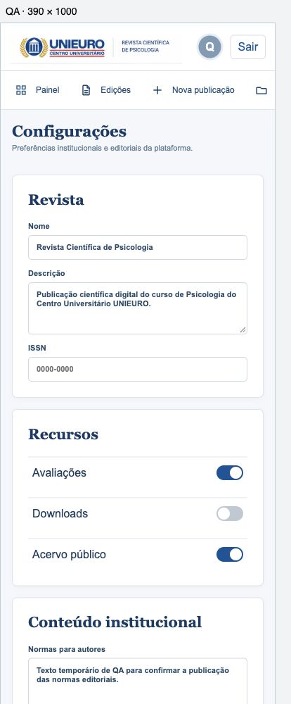
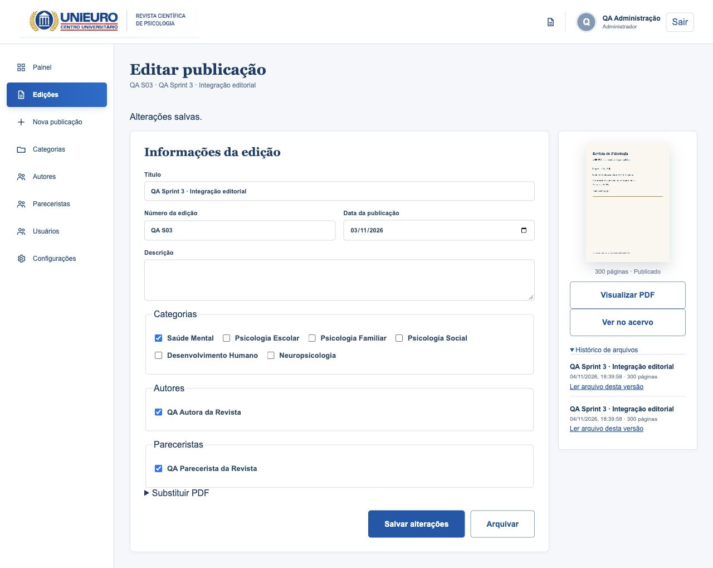

# Entrega técnica S03 — administração e pacote Docker

Registro em **04/11/2026**, sobre o frontend final recebido. O cliente informou que
ainda não há servidor/domínio e solicitou preparar o pacote Docker. Não foi contratado
serviço externo, instalado certificado no sistema ou publicado site na internet.

## Comportamento entregue

- Usuários reais, três perfis, gestão exclusiva do administrador, senha forte,
  desativação e proteção do último administrador, incluindo concorrência real no banco.
- Autores e pareceristas separados de contas, vínculos ordenados, contagens reais e
  preservação de vínculos históricos com pessoas/categorias desativadas.
- Configuração institucional persistente, ISSN validado, normas/política/contato no
  rodapé e opções de avaliações/download/acervo aplicadas também pelo servidor.
- Auditoria com nomes do responsável/registro preservados e nomes dos campos alterados;
  sem conteúdo de senhas ou payloads. Expiração de sessão retorna ao login/destino.
- Catálogo/indicadores reais, paginação visual e filtros; capas com carregamento tardio.
- Histórico de publicações/PDFs: URL com UUID da versão mantém os mesmos bytes em Range
  mesmo após trocar o PDF. Arquivar revoga todas as versões públicas. A prévia privada
  continua condicionada ao perfil/propriedade. Última gravação de formulário vence;
  detecção otimista de formulário antigo não foi implementada.
- Limite de votos atômico no Redis e falha explícita se o limitador estiver indisponível.
- Imagens de produção Nginx/Gunicorn/Celery, API não root, TLS/cookies seguros, volume
  privado, localização Nginx interna e arquivos parciais após autorização Django.
- Backup coerente com manutenção breve, checksums, validação de caminhos e restauração
  somente em ambiente vazio; limpeza de órfãos com 30 dias e simulação por padrão.
- Manuais [operacional](16-operacao-docker.md) e [editorial](17-manual-editorial.md),
  gerador de configuração privada e empacotador vinculado a um commit limpo.

## Verificação reproduzível

`make check`: **48 testes backend + 4 testes Node**, PostgreSQL real, validação de
perfis/CSRF, ciclo editorial, arquivos, configuração, limites, último admin concorrente,
histórico imutável, segurança do backup, Ruff/ESLint/TypeScript e build aprovados.
`make schema`: sem avisos/erros, migrações sem divergência. `npm audit`: 0 vulnerabilidades.
O build mantém o aviso de tamanho do chunk PDF.js, carregado apenas ao abrir o leitor.

`smoke_production.py` executou no Compose de produção descartável, com HTTPS e CA
explicitamente confiada pelo cliente de teste, sem desativar TLS. Envio real de PDF
textual de 300 páginas e digitalizado de 300, rejeição de 301, créditos, rascunho,
publicação, hash, HEAD/206/416, bloqueio de caminho interno, flags, avaliação,
arquivar/restaurar, auditoria e troca de PDF com acesso à versão antiga aprovados.
[Relatório sem credenciais](evidencias/s03/smoke-producao.json).

Backup PostgreSQL/arquivos restaurado em volumes de outro projeto; metadados, créditos
e SHA-256 de ambos os PDFs preservados. A suíte CI repete essa jornada, incluindo
resolução do PDF anterior depois da substituição. Apenas o relatório sem credenciais
é artefato do CI; banco, certificados e variáveis não são publicados.

## Verificação visual e de interação

Browser plugin não disponível; usado navegador integrado via CUA. Fluxo: login →
cadastros → PDF300 → créditos → publicar → editar → portal → normas/configuração.
Cadastros/contato/switches/créditos e data foram conferidos após salvar e recarregar.
O perfil editor não vê menus de usuários/configurações; link direto retorna acesso
restrito. Histórico e retorno ao destino após login conferidos. Console da jornada
final de detalhe sem erros capturados. Tab no formulário móvel avançou de Nome para
E-mail profissional com foco visível.

| Viewport CSS | Tela conferida | Largura do documento |
|---|---|---|
| 390 px | Configurações, publicações e formulário de autor | 390 px |
| 768 px | Usuários | 768 px |
| 1024 px | Autores e formulário | 1024 px |
| 1440 px | Nova publicação | 1440 px |

As larguras foram medidas em iframe de mesma origem com dimensão explícita no navegador
de desktop. Isso verifica layout responsivo, não equivale a testar toque/teclado virtual
em um aparelho físico. Capturas usam contas e PDF sintéticos de QA, removidos após revisão.

## Limites e aceite pendente

A prova anterior do leitor mantém no máximo dois canvases de páginas e dez miniaturas,
com uma página/sem miniaturas em viewport estreito. Há navegação longa documentada na
[S02](14-sprint2-pdf-real.md), mas não houve medição completa de heap, carga simultânea,
matriz de rede ou PDFs no limite de 200 MiB. Não declarar esses critérios aprovados.

Faltam testes em celulares físicos e matriz Chrome/Firefox/Safari/Edge, revisão completa
de acessibilidade e aceite visual pelo cliente. A comparação com a referência deve
partir do frontend final escolhido, preservado nesta entrega. Não houve aceite humano.

Ainda faltam host/domínio, emissão/renovação TLS, backup agendado externo, alertas com
destinatário, capacidade/RPO/RTO comprovados no host final, demonstração e transferência
de acessos. As tarefas de homologação final/operação continuam abertas. Não foi criada
tag v1.0.0 nem declarado encerramento integral do projeto.
